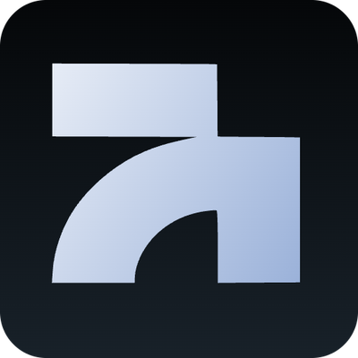

<p align="center"></p>

# Skael API MCP server

Lead lists from Google Maps, websites, job boards and German company registers, with verified emails.

Skael API is a **hosted, remote MCP server**. There is nothing to clone, build or run: point your MCP client at the endpoint below and sign in. This repository holds the setup guide; the server source is not public.

| | |
| --- | --- |
| Endpoint | `https://api.skael.de/mcp` |
| Transport | Streamable HTTP |
| Auth | OAuth 2.1 (dynamic client registration, PKCE) or a personal token as `Authorization: Bearer eak_…` |
| Official MCP Registry | [`de.skael.api/skael`](https://registry.modelcontextprotocol.io/v0.1/servers?search=de.skael.api/skael) |
| Docs | https://api.skael.de/docs/mcp |
| Website | https://api.skael.de/en/ (free sign-up with free credits) |

## What it does

Describe your target customers in plain language in Claude, ChatGPT, Cursor, Cline or any client with remote MCP support. Skael API finds companies and decision-makers on Google Maps, company websites and imprints, job boards and the German commercial register (Handelsregister), and verifies every email before it lands in your list. It works worldwide; the German register data is its strength.

- **Lead lists:** a short interview about your target group, a paid test on a small sample, and after your OK the full run. The CSV arrives by mail and on the run page.
- **Single lookups:** the verified website for a company name, email finder, email verification, Handelsregister company data, LinkedIn enrichments.
- **Your account:** usage, campaigns, prospects, members and API keys.

Every tool that costs credits states the price first. Anything above 500 credits needs your explicit confirmation in the chat.

## Setup

### Cursor

`~/.cursor/mcp.json`:

```json
{
  "mcpServers": {
    "skael": { "url": "https://api.skael.de/mcp" }
  }
}
```

Cursor opens the Skael API sign-in on the first call.

### Claude Code

```bash
claude mcp add --transport http skael https://api.skael.de/mcp
```

Then run `/mcp` and choose Authenticate. With a token instead: create one under Settings → MCP in the Skael API dashboard and add `--header "Authorization: Bearer <YOUR_MCP_TOKEN>"`.

### Claude (claude.ai, Claude Desktop)

Settings → Connectors → Add custom connector. Name `Skael API`, URL `https://api.skael.de/mcp`, then Connect and sign in.

### ChatGPT

Developer mode → Apps → Create. MCP server URL `https://api.skael.de/mcp`, authentication OAuth.

### Cline

See [llms-install.md](llms-install.md).

### VS Code

```json
{
  "servers": {
    "skael": { "type": "http", "url": "https://api.skael.de/mcp" }
  }
}
```

## Tokens

A personal MCP token (`eak_…`) is created per member on `/settings/mcp` in the dashboard. Send it as `Authorization: Bearer eak_…`. Never put a token into the URL.

## Operator and support

Skael API is operated by Skael (David Lionel Wassilowsky, sole proprietorship, Germany). Imprint: https://api.skael.de/impressum · Terms: https://api.skael.de/agb

Questions or problems: open an issue in this repository.
